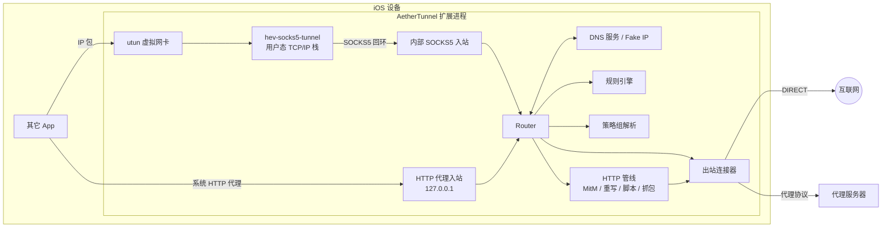
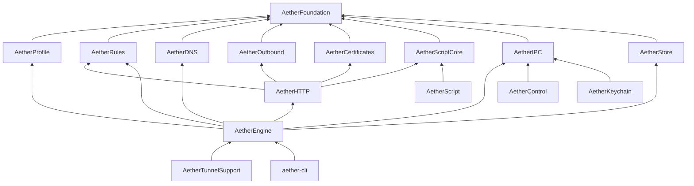
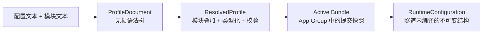
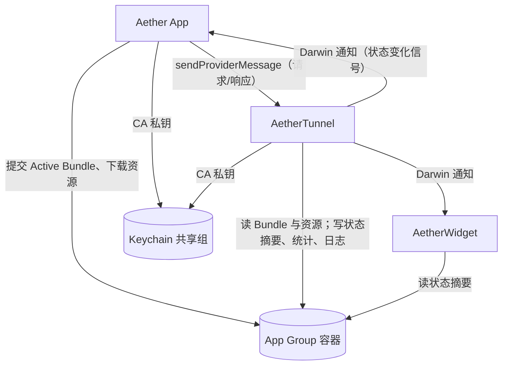

# 02 总体架构

## 1. 总览

Aether 由一个主 App 和若干系统扩展组成。所有网络处理都在 Packet Tunnel 扩展进程（下称"隧道"）内完成；主 App 只负责配置、展示和控制，它不运行时隧道也必须正常工作。



两条入口：

1. **系统 HTTP 代理**：隧道在网络设置中声明 HTTP/HTTPS 代理为本地端口。遵守系统代理的流量（绝大多数 `URLSession` 流量）直接以 HTTP 代理协议进入引擎，自带域名，无需经过用户态协议栈，开销最小。
2. **TUN**：其余 IP 包进入 utun，由 hev-socks5-tunnel 的用户态协议栈还原成 TCP 连接与 UDP 会话，再以 SOCKS5 协议经回环地址交给引擎。域名通过 Fake IP 反查恢复（见 [07](07-dns.md)）。

两条入口进入同一个 `Router`，之后的规则、策略、出站处理完全相同。

## 2. Target

| Target | 类型 | Bundle ID | 职责 | 里程碑 |
| --- | --- | --- | --- | --- |
| `Aether` | iOS App（SwiftUI） | `$(AETHER_BUNDLE_ID_PREFIX)` | 配置管理与编辑、外部资源下载、隧道控制、观测界面、证书安装引导 | M0 |
| `AetherTunnel` | Packet Tunnel Provider 扩展 | `$(AETHER_BUNDLE_ID_PREFIX).tunnel` | 网络引擎的宿主：生命周期、网络设置、TUN 接入、IPC 处理 | M0 |
| `AetherWidget` | WidgetKit 扩展（含 Controls） | `$(AETHER_BUNDLE_ID_PREFIX).widget` | 主屏 / 锁屏小组件、控制中心开关 | M4 |
| `AetherShare` | Share 扩展 | `$(AETHER_BUNDLE_ID_PREFIX).share` | 从其它 App 接收 URL / 文件并放入导入收件箱 | M7 |

所有 Target 共享同一个 App Group 与 Keychain Access Group。标识符全部来自 xcconfig，代码从 Info.plist 读取，**不得硬编码**（见 [03 §3](03-project-setup.md#3-标识符与签名配置)）。

Target 内只放平台胶水代码和界面；业务逻辑全部在 Swift Package `AetherKit` 中。

## 3. 模块（AetherKit）

### 3.1 模块清单

| 模块 | 平台 | 主要依赖 | 职责 |
| --- | --- | --- | --- |
| `AetherFoundation` | 全部 | swift-log、swift-collections | 基础类型：`IPAddress`、`CIDR`、`Endpoint`、`Hostname`、LRU、错误码、日志工具、字节工具、cron 表达式、gzip 解压（`Inflate`）与 SHA-256 / SHA-224（`SHA2`）；规则词汇类型 `RuleSpec` / `RuleCondition`（由 `AetherProfile` 产出、`AetherRules` 编译，见 05 §1） |
| `AetherProfile` | 全部 | Yams | 配置的无损解析、类型化模型、模块叠加、校验与诊断、订阅与节点格式导入 |
| `AetherRules` | 全部 | — | 规则编译与匹配、规则集与域名集、MMDB 读取器 |
| `AetherDNS` | 全部 | swift-nio | DNS 报文编解码、上游客户端、缓存、Fake IP 池、Host 映射 |
| `AetherOutbound` | 全部 | swift-nio、swift-nio-ssl、swift-certificates、swift-crypto、CBlake3 | 出站连接器与各代理协议、传输层（TLS、WebSocket、obfs） |
| `AetherCertificates` | 全部 | swift-certificates、swift-crypto | MitM 的 CA 生成、叶子证书签发、`.mobileconfig` 生成、CA 备份格式加解密 |
| `AetherScriptCore` | 全部 | — | `ScriptRuntime` 协议、脚本值类型、`ScriptHostServices` 协议（网络请求、存储、通知、GeoIP 等由宿主注入）、cron 表达式解析 |
| `AetherHTTP` | 全部 | swift-nio（HTTP1/HTTP2）、swift-nio-http2、swift-nio-ssl | 经出站连接器的最小 HTTP 客户端（测速 `HTTPProbe`、资源下载 `HTTPFetch`）、DoH / DoT 客户端、TLS 终止、HTTP 处理管线、重写、抓包、调用 `ScriptRuntime` |
| `AetherEngine` | 全部 | 以上全部 + `AetherIPC`、`AetherStore` | 入站、`Router`、流管理、策略组、统计、运行配置装配与热替换、IPC 命令处理 |
| `AetherIPC` | 全部 | — | App ↔ 隧道消息类型、`AppEnvironment`、共享路径、状态快照模型、Darwin 通知名、外部资源缓存与更新（`ResourceCache`、`ResourceUpdater`，下载方式由两侧注入） |
| `AetherStore` | 全部 | GRDB | 流量统计、请求历史、日志簿、脚本存储的数据库访问 |
| `AetherScript` | Apple | JavaScriptCore | `ScriptRuntime` 的 JavaScriptCore 实现与 JS API 桥接 |
| `AetherControl` | Apple | NetworkExtension | App 侧隧道管理（`TunnelController`）、IPC 客户端（`TunnelClient`）、状态观察；App 与小组件共用 |
| `AetherKeychain` | Apple | Security、`AetherIPC` | Keychain 访问：启动时探测访问组的 Team ID 前缀（03 §8.4）；M5 起存取 MitM CA 私钥；App 与隧道共用 |
| `AetherTunnelSupport` | Apple | NetworkExtension、Network、CHevSocks5Tunnel、CAetherTunnel | 隧道网络设置构建、utun 描述符获取、hev 桥接、网络路径监控、Darwin 通知发送 |
| `aether-cli` | 全部（可执行） | `AetherEngine` 等 | 开发调试命令行：校验配置、规则测试、在本机以 SOCKS5/HTTP 入站运行引擎 |
| `AetherTestSupport` | 全部（仅测试） | swift-nio（回环测试服务） | 测试数据访问（`Fixtures`，定位 `Tests/Fixtures/`）、十六进制等测试工具；任何产品模块都不得依赖它 |

C 依赖：

| 模块 | 形式 | 说明 |
| --- | --- | --- |
| `CHevSocks5Tunnel` | 二进制 target（xcframework），仅 Apple | 由 `Vendor/hev-socks5-tunnel` 子模块编译，见 [03 §6](03-project-setup.md#6-vendored-c-库) |
| `CBlake3` | 源码 target | BLAKE3 官方 C 实现，供 Shadowsocks 2022 使用 |
| `CAetherTunnel` | 源码 target，仅 Apple | 隧道的系统接口胶水：按内核 ABI 声明 `ctl_info` / `sockaddr_ctl` 并查找 utun 描述符、经 libresolv 读取系统 DNS 服务器（[06 §4.1](06-network-engine.md#41-获取-utun-描述符)） |

### 3.2 依赖方向



约束：

- **不得**出现反向依赖或环。`AetherProfile` 只产出类型化描述（`RuleSpec`、`ProxySpec` 等），不依赖规则引擎或协议实现；编译成可执行结构是 `AetherEngine` 的职责。
- 标记为"全部"的模块**必须**能在 Linux 上编译并通过测试，因此不得 `import` UIKit、SwiftUI、NetworkExtension、JavaScriptCore、CryptoKit、Network、Security 等 Apple 专有框架；需要平台能力时在该模块定义协议，由 Apple 专有模块或 Target 注入实现。加密统一用 swift-crypto（在 Apple 平台上自动转发到 CryptoKit）。
- `AetherScript` 实现 `AetherScriptCore` 中定义的 `ScriptRuntime` 协议；脚本需要的宿主能力（`$httpClient`、`$persistentStore`、`$notification`、`$utils.geoip` 等）通过 `ScriptHostServices` 注入：隧道注入引擎实现，App 的脚本调试注入基于 `URLSession` 的实现。Linux 上以 `UnavailableScriptRuntime` 替代，测试使用 mock。
- App Target 依赖 `AetherProfile`、`AetherRules`（规则测试工具）、`AetherIPC`、`AetherStore`、`AetherControl`、`AetherCertificates`（M5）、`AetherScript`（M6，脚本调试），**不得**直接或间接依赖 `AetherEngine`、`AetherOutbound`、`AetherHTTP`。App 内需要的网络请求（下载外部资源）使用 `URLSession`。
- 小组件 Target 依赖 `AetherIPC`、`AetherControl`，以及切换配置的 Intent 需要的 `AetherProfile`；同样不得依赖引擎相关模块。

## 4. 配置从文本到运行



| 阶段 | 所在位置 | 输入 → 输出 | 失败时 |
| --- | --- | --- | --- |
| 解析 | App、隧道、CLI | 文本 → `ProfileDocument` | 产出诊断，语法错误行保留为原文 |
| 解析与校验 | App、隧道、CLI | `ProfileDocument` + 模块 → `ResolvedProfile` | 有 error 级诊断时不得提交 |
| 提交 | App | `ResolvedProfile` 的源文件 → Active Bundle（写入新目录后原子切换指针文件，见 [11 §6](11-storage.md#6-提交运行包)） | 旧 Bundle 不变 |
| 编译 | 隧道 | Active Bundle + 资源缓存 → `RuntimeConfiguration` | 保留旧运行配置继续服务，报告错误 |
| 热替换 | 隧道 | 新 `RuntimeConfiguration` 原子替换引用 | — |

关键决策：**隧道自己编译**，App 只做校验和提交（ADR-006）。这样隧道启动不依赖 App 运行，也不存在 App 与隧道对同一份编译产物的版本兼容问题。

## 5. 进程协作



规则：

1. **隧道自给自足**：启动只依赖 App Group 中的 Active Bundle 和资源缓存；启动、运行、重载都不得等待 App 消息。
2. **单写者**：每份共享数据只有一个写者。隧道运行时，策略组选择、功能开关、出站模式由 App 通过 IPC 请求隧道修改并由隧道落盘；隧道未运行时 App 直接写。具体归属见 [11 §2](11-storage.md#2-单写者归属)。
3. **IPC 只传小消息**：单条消息负载应小于 256 KiB；大数据（请求列表、日志）分页或写入文件后传路径。协议见 [10](10-control-ipc.md)。
4. **通知只是信号**：Darwin 通知不带数据，收到后由接收方主动拉取。
5. **原子文件写**：所有共享文件以"写临时文件 → `rename`"方式更新；读方容忍文件缺失或损坏并回退到默认值。

## 6. 内存预算

iOS 对 Packet Tunnel 扩展有硬性内存上限，超过即被系统终止。公开信息中该上限在现代设备上为 50 MiB，且 Apple 明确表示可能随系统版本与设备变化、旧设备上可能更低。因此：

- **不得**在代码中硬编码上限；运行时用 `os_proc_available_memory()` 读取剩余额度。
- 设计目标：常态峰值 ≤ 30 MiB，压力测试峰值 ≤ 40 MiB，保留 ≥ 10 MiB 余量。

| 组成 | 预算 | 控制手段 |
| --- | --- | --- |
| 进程基线（运行时、框架、线程） | ≤ 10 MiB | 1 个 NIO EventLoop 线程；不引入大型框架 |
| hev 协议栈 | ≤ 6 MiB | `tcp-buffer-size`、`task-stack-size`、`max-session-count`（初值见 [06 §4](06-network-engine.md#4-tun-接入hev-socks5-tunnel)） |
| 连接缓冲 | ≤ 8 MiB | 每流读缓冲上限 + 背压；全局并发流上限 |
| 规则与资源 | ≤ 8 MiB | 紧凑数据结构；MMDB 用 `mmap` 只读映射 |
| DNS 缓存与 Fake IP 表 | ≤ 2 MiB | LRU 容量上限 |
| TLS | ≤ 3 MiB | 共享 `NIOSSLContext`；叶子证书 LRU |
| 脚本运行时 | ≤ 6 MiB（仅活动时） | 惰性创建、空闲回收、并发 ≤ 2 |
| 观测数据 | ≤ 2 MiB | 请求记录环形缓冲、日志缓冲上限 |

内存压力处理（`DispatchSource.makeMemoryPressureSource`）：

| 级别 | 动作 |
| --- | --- |
| warning | 清空 DNS 正向缓存（保留 Fake IP 表）、清空叶子证书缓存、关闭空闲出站连接、释放空闲 JS 虚拟机、请求记录环缩减到 1/4 |
| critical | 以上全部 + 暂停接受新的抓包 Body + 新流按 `REJECT` 处理 10 秒 + 写日志簿事件 |

内存数据（当前 footprint、剩余额度、各组件估算）通过 IPC 暴露给 App 的诊断页面，并在每次压力事件时写入日志簿。

实现（M2-10）：warning 清空 DNS 正向缓存与反查表（保留 Fake IP 表）、请求记录环缩减到 1/4；critical 另外使新流以 `NET-041` 拒绝 10 秒，日志簿事件带该码。证书缓存、空闲出站连接与 JS 虚拟机的释放随对应组件在 M3–M6 接入。footprint 取自 `task_info(TASK_VM_INFO).phys_footprint`，剩余额度取自 `os_proc_available_memory()`（仅 iOS）。

## 7. 线程与并发

| 执行上下文 | 承载内容 | 规则 |
| --- | --- | --- |
| NIO EventLoop（默认 1 线程） | 全部数据面：入站、路由、出站、DNS 报文收发、HTTP 管线 | 不得阻塞；不得在其上 `await` 长任务；CPU 密集操作（大规则集编译、证书签发）移出 |
| hev 线程 | hev 的协程调度器 | 由 `hev_socks5_tunnel_main_from_str` 占用，独立 `Thread` |
| 脚本线程（1–2） | JavaScriptCore 虚拟机 | 每个 VM 只在自己的线程上使用 |
| Swift Concurrency 协作池 | 控制面：IPC 处理、运行配置编译、外部资源更新、测速调度 | 结果回到 EventLoop 生效 |

- Swift 6 语言模式，开启完整并发检查。数据面类型以"绑定到 EventLoop"的方式保证线程安全（`NIOLoopBound`、`EventLoop.assertInEventLoop()`），控制面类型用 `actor`。
- `RuntimeConfiguration` 是不可变值，通过原子引用发布。新流使用最新引用；已存在的流持有旧引用直到结束。
- 数据面使用 ChannelHandler 管线 + 双向"胶水"转发（参考 SwiftNIO 的 connect-proxy 示例），**不应**把逐包数据转成 `AsyncSequence` 处理，以免额外分配和调度开销。

## 8. 错误与日志

### 8.1 错误

所有可展示给用户或写入请求记录的错误都实现 `AetherErrorProtocol`：

```swift
public protocol AetherErrorProtocol: Error, Sendable {
    var code: AetherErrorCode { get }      // 稳定错误码，如 .netConnectTimeout -> "NET-002"
    var isRetryable: Bool { get }
    var debugDetails: String { get }       // 不含敏感信息
}
```

错误码命名空间：`CFG`（配置诊断，见 [04 §13](04-profile-spec.md#13-诊断码)）、`NET`（连接）、`DNS`、`TLS`、`MITM`、`SCR`（脚本）、`IPC`、`RES`（外部资源）、`STO`（存储）。错误码一经发布不得改变含义。人类可读说明放在 String Catalog 中，键为错误码。

### 8.2 日志

- 统一使用 swift-log 门面，进程启动早期调用 `AetherLogging.bootstrap`（`AetherFoundation`）。Apple 平台后端写入 `os.Logger`（subsystem = Bundle ID 前缀，category = 日志标签，即模块名），同时写入 App Group 中的滚动日志文件 `Logs/<tunnel|app>.0.log`（当前）与 `.1.log`（上一个），每个 1 MiB；行格式 `<UTC 毫秒时间> <级别> [<标签>] <消息> key=value…`，单行上限 4 KiB（超出截断），写入失败时丢弃该行并计数，不影响调用方。
- 级别：`debug`、`info`、`notice`、`warning`、`error`。默认 `notice`；配置项 `loglevel` 与运行时 IPC 可调整。
- **不得**记录：密码、密钥、UUID 类凭据、Cookie / Authorization 头的值、请求 Body。`info` 及以上只记录主机名，`debug` 才可记录 URL 路径。
- 不得使用 `print`。

日志簿（Logbook）与日志不同：只记录用户关心的事件（隧道启停、配置重载结果、资源更新成功/失败、内存压力、证书状态变化），持久化到数据库，在 App 中按时间线展示。

## 9. 安全边界

| 面 | 措施 |
| --- | --- |
| 内部 SOCKS5 入站（hev 用） | 只监听 `127.0.0.1` 随机端口；每次隧道启动生成随机用户名和密码，只传给 hev |
| HTTP 代理入站（系统代理） | 只监听 `127.0.0.1`；系统代理设置无法携带认证，故不认证（与同类工具一致，记录为已接受风险） |
| HTTP 控制接口（M7） | 默认关闭；开启时必须设置密钥；默认只监听 `127.0.0.1` |
| 局域网共享（M7） | 默认关闭；开启时在首页显著提示 |
| MitM CA 私钥 | 存 Keychain（`kSecAttrAccessibleAfterFirstUnlockThisDeviceOnly`，共享访问组）；只有用户显式"导出 CA（带口令）"时离开设备 |
| 配置中的凭据 | 文件位于 App Group，数据保护级别 `completeUntilFirstUserAuthentication`；导出、分享、截图预览默认脱敏 |
| 脚本 | 运行在 JavaScriptCore 沙盒中，无文件系统访问；网络请求走引擎并受策略约束；有超时与大小上限（见 [09](09-scripting.md)） |
| 外部资源下载 | 默认要求 HTTPS；HTTP 资源允许但标注警告；单个资源大小上限 32 MiB |

## 10. 架构决策记录（ADR）

每条决策给出"重新评估条件"。触发条件时开 issue 讨论，结论写回本节。

**ADR-001 引擎用 Swift + SwiftNIO 自研，不嵌入 Go / Rust 现成内核**
- 理由：单一语言，MitM、重写、脚本与路由深度集成；依赖全部为宽松许可证；核心模块可在 Linux 上做单元与互通测试。
- 代价：代理协议需逐个实现与互通验证。
- 重新评估：某个协议（如 QUIC 系）用 Swift 实现成本过高时，可单独引入宽松许可证的 C / Rust 库，只作为该协议的连接器。

**ADR-002 TUN 接入使用 hev-socks5-tunnel，经回环 SOCKS5 交给引擎**
- 理由：MIT 许可，C 实现，内存占用低，同时支持 TCP、UDP、IPv4/IPv6；引擎只需实现 SOCKS5 入站即可接入。
- 代价：每个 TUN TCP 连接多一次回环转发，多占用文件描述符。
- 重新评估：性能测试（M7）中回环开销成为瓶颈时，评估直接嵌入 lwIP 并在进程内对接。

**ADR-003 DNS 默认 Fake IP 模式**
- 理由：TUN 流量可以无损恢复域名，域名规则无需真实解析，代理节点可在远端解析。
- 代价：需要维护映射表并处理持久化、真实 IP 例外名单（见 [07](07-dns.md)）。

**ADR-004 数据面使用 NIOPosix（BSD socket），不使用 NIOTransportServices**
- 理由：iOS 与 Linux 使用同一套传输代码，互通测试结果可直接代表设备行为；UDP 非连接模式更简单。隧道进程自身发起的连接默认不进入自身隧道。
- 代价：失去 Network.framework 的路径感知与自动唤起蜂窝等能力。🔬 需要真机验证"仅蜂窝网络、刚开机"场景下 BSD socket 出站的可用性。
- 重新评估：若该场景失败，DIRECT 与代理服务器的 TCP 连接改用 NIOTransportServices，协议处理器保持不变。

**ADR-005 TLS 统一使用 swift-nio-ssl**
- 理由：MitM 需要在内存中按主机名即时签发证书并作为服务端身份，Network.framework 需要 Keychain 中的 `SecIdentity`，无法满足；客户端与服务端用同一套实现也便于测试。
- 代价：增加 BoringSSL 的二进制体积。

**ADR-006 隧道自行编译运行配置**：见 §4。

**ADR-007 配置语法兼容业界通用 INI 风格，模型无损**
- 理由：用户迁移成本最低；无损模型让表单编辑不破坏注释与顺序。

**ADR-008 Xcode 工程由 XcodeGen 生成，`.xcodeproj` 不入库**
- 理由：工程定义是可审阅的 YAML，避免 `project.pbxproj` 合并冲突，任何环境都能编辑工程结构。

**ADR-009 只引入宽松许可证依赖**
- 允许：MIT、BSD-2/3、Apache-2.0、ISC、Zlib、CC0、MPL-2.0（仅限未修改的独立文件）。禁止：GPL、AGPL、LGPL、SSPL 及无许可证代码。新增依赖必须更新 [03 §5](03-project-setup.md#5-依赖) 的依赖表。

**ADR-010 脚本运行时用 JavaScriptCore 公开 API，不使用私有 API**
- 代价：无法强制中断同步死循环，以隔离与熔断弥补（见 [09 §3](09-scripting.md#3-运行时设计)）。
