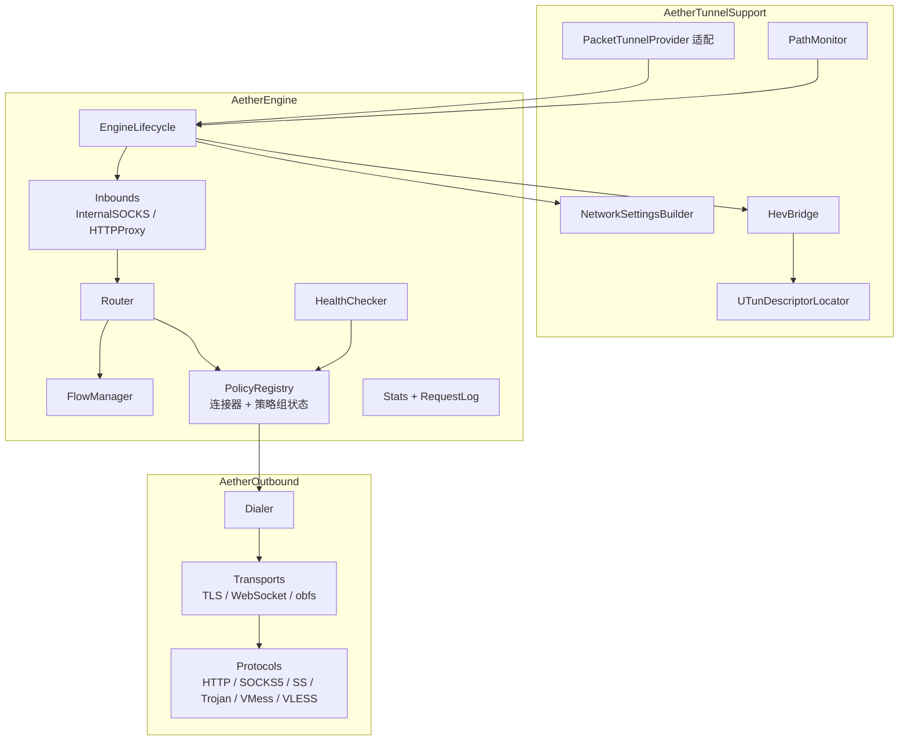

# 06 网络引擎

本章定义隧道扩展内的网络数据面：隧道生命周期、入站、路由、出站协议、策略组、UDP、网络切换、统计与资源控制。涉及模块：`AetherTunnelSupport`（平台胶水）、`AetherEngine`（编排）、`AetherOutbound`（协议）。

## 1. 组件



`PacketTunnelProvider` 本身只做转发：把系统回调转成 `EngineLifecycle` 的方法调用，把 `handleAppMessage` 交给 IPC 分发器（见 [10](10-control-ipc.md)）。

## 2. 隧道生命周期

### 2.1 状态机

```text
idle ──start──▶ starting ──成功──▶ running
                   │                 │  ├─reload──▶ reloading ──▶ running（失败则保留旧配置）
                   │                 │  └─设置变更──▶ reasserting ──▶ running
                   └─失败──▶ failed ──▶ idle
running / reloading / reasserting ──stop──▶ stopping ──▶ idle
```

状态与时间戳写入状态快照（[10 §3](10-control-ipc.md#3-状态快照)）。

### 2.2 启动

`startTunnel(options:completionHandler:)` 依次执行，任何一步失败都按相反顺序撤销已完成的步骤，并以带错误码的 `NSError` 调用 completion：

1. 初始化日志；读取 `AppEnvironment`；把 `RLIMIT_NOFILE` 软限制提高到 `min(硬限制, 8192)`（每个 TUN TCP 连接会占用 3 个描述符，默认 256 远远不够）。
2. 读取 Active Bundle 清单；不存在 → `IPC-010 没有可用配置`。
3. 在控制面编译 `RuntimeConfiguration`（含外部资源缓存）；失败 → 返回诊断摘要。
4. 读取持久化状态：出站模式、功能开关、策略组选择、Fake IP 快照（[11 §2](11-storage.md#2-单写者归属)）。
5. 启动 `EventLoopGroup`（1 线程）、DNS 服务、内部 SOCKS5 入站（随机端口）、HTTP 代理入站（`system-proxy = true` 时）。
6. 构建并应用隧道网络设置（§3），等待 `setTunnelNetworkSettings` 完成。
7. 获取 utun 描述符，启动 hev 线程（§4）。
8. 启动路径监控、cron 调度、外部资源定时更新。
9. 写状态快照（`running`）、发出状态通知、调用 completion。

要求：

- completion **恰好调用一次**（用一次性守卫包装）。
- 整个启动目标 < 3 秒（不含首次编译超大规则集）；超过 15 秒视为失败。
- 启动不等待任何 App 消息，不发起任何必需的网络请求（外部资源缺失时使用缓存，没有缓存则该资源不可用并记录日志簿）。

### 2.3 停止

`stopTunnel(with:completionHandler:)`：

1. 状态置 `stopping`；入站停止接受新连接。
2. `hev_socks5_tunnel_quit()`，等待 hev 线程退出（最多 3 秒）。
3. 关闭全部流：先半关闭等待 1 秒，再强制关闭。
4. 落盘：Fake IP 快照、策略组选择、流量统计、请求历史（若开启）。
5. 关闭 EventLoopGroup。
6. 写状态快照（`idle`，附停止原因）、发出通知、调用 completion。

### 2.4 重载

触发：App 发 `reloadProfile`（配置或模块变化）、托管配置或外部资源更新成功、HTTP 控制接口（M7）。

1. 在控制面编译新的 `RuntimeConfiguration`；失败 → 返回诊断，保留旧配置继续服务，写日志簿。
2. 计算差异：
   - 隧道网络设置变化（路由、DNS、MTU、系统代理、`skip-proxy`）→ `reasserting = true`，重新 `setTunnelNetworkSettings`，完成后 `reasserting = false`；
   - MTU 变化 → 重启 hev（TUN 上的现有流会中断，在日志簿记录）；
   - 入站端口变化 → 重启对应入站。
3. 原子替换运行配置引用。新流使用新配置；已有流保持旧配置直到结束。
4. 策略组状态迁移：同名同类型的组保留选择与测速结果；选择的成员已不存在时回到第一个成员。
5. 清空规则决策缓存、Fake IP 之外的 DNS 正向缓存保持不变。

### 2.5 休眠与唤醒

- `sleep(completionHandler:)`：暂停测速与 cron 定时器，落盘统计，调用 completion。
- `wake()`：网络修订号加一，恢复定时器，对活动策略组安排一次测速（去抖 2 秒）。

## 3. 隧道网络设置

`NetworkSettingsBuilder`（`AetherTunnelSupport`）把平台无关的 `TunnelNetworkSettingsSpec`（`AetherEngine`，可在 Linux 上测试）转换为 `NEPacketTunnelNetworkSettings`；M2-09 起 spec 由运行配置生成（M0 的空隧道见 `TunnelNetworkSettingsSpec.emptyTunnel`：只路由 `198.18.0.0/15`、不改 DNS）。完整设置：

| 项 | 值 |
| --- | --- |
| `tunnelRemoteAddress` | `127.0.0.1` |
| `mtu` | `tun-mtu`（默认 1500） |
| IPv4 地址 | `198.18.0.1`，掩码 `255.255.255.255` |
| IPv4 包含路由 | `tun-included-routes`，为空时为默认路由；**始终**包含 `fake-ip-range` |
| IPv4 排除路由 | `skip-proxy` 中的 CIDR ∪ `tun-excluded-routes` ∪ `{224.0.0.0/4, 255.255.255.255/32}` |
| IPv6 地址 | `fd00:ae7e::1/128` |
| IPv6 包含路由 | 默认路由（即使 `ipv6 = false` 也接管 IPv6，防止 IPv6 字面量流量绕过） |
| IPv6 排除路由 | `skip-proxy` 中的 IPv6 CIDR ∪ `{fe80::/10, ff00::/8}` |
| DNS | 服务器 `198.18.0.2`，`matchDomains = [""]`（接管全部域名） |
| 系统代理（`system-proxy = true`） | HTTP 与 HTTPS 均为 `127.0.0.1:6171`；`exceptionList` 为 `skip-proxy` 全部条目；`excludeSimpleHostnames` 取配置；`matchDomains = [""]` |

`ipv6 = false` 时 IPv6 路由仍进入隧道，但 DNS 不返回 AAAA（[07](07-dns.md)），所以只有直接使用 IPv6 字面量的流量会以 IPv6 到达引擎，按规则正常处理。

App 侧 `NETunnelProviderProtocol`：`providerBundleIdentifier` 取自 `AppEnvironment`，`serverAddress = "Aether"`，`disconnectOnSleep = false`，`includeAllNetworks = false`。按需连接规则见 [10 §4](10-control-ipc.md#4-隧道管理app-侧)。

## 4. TUN 接入（hev-socks5-tunnel）

### 4.1 获取 utun 描述符

`setTunnelNetworkSettings` 完成后，遍历描述符 0…1024：对每个描述符 `getpeername`，地址族为 `AF_SYSTEM` 时用 `CTLIOCGINFO` 查询控制名 `com.apple.net.utun_control` 的 ID，`sc_id` 相等者即为 utun 描述符。相关结构与常量（`ctl_info`、`sockaddr_ctl`、`CTLIOCGINFO`、`AF_SYSTEM`）不在 iOS SDK 的公开头文件中，在 `AetherTunnelSupport` 的一个 C 头文件里按内核 ABI 自行声明。这是开源 VPN 客户端的通行做法，不调用私有 API。

找不到描述符时使用**备用桥接**：创建一对 `SOCK_DGRAM` 的 `socketpair`，一端交给 hev，另一端由 Swift 代码在 `packetFlow.readPackets` / `writePackets` 与 socket 之间搬运，按 utun 格式加上或去掉 4 字节地址族头。备用桥接有额外开销，启用时写日志簿警告。🔬 两条路径都要在真机上验证。

### 4.2 hev 配置

隧道启动时在内存中生成 YAML，以 `hev_socks5_tunnel_main_from_str(config, len, fd)` 启动：

```yaml
tunnel:
  mtu: 1500                 # = tun-mtu
  ipv4: 198.18.0.1
  ipv6: 'fd00:ae7e::1'
socks5:
  address: 127.0.0.1
  port: 52345               # 内部 SOCKS5 入站的随机端口
  udp: 'udp'                # 使用 SOCKS5 UDP ASSOCIATE
  username: '<随机 16 字节十六进制>'
  password: '<随机 16 字节十六进制>'
misc:
  task-stack-size: 65536    # 初值，M2 实测后定值
  tcp-buffer-size: 16384    # 初值，M2 实测后定值
  max-session-count: 1024
  connect-timeout: 10000
  tcp-read-write-timeout: 300000
  udp-read-write-timeout: 60000
  log-level: warn
```

- 不使用 hev 的 `mapdns`：DNS 全部交给 Aether 的 DNS 服务（`198.18.0.2:53` 的 UDP 包经 SOCKS5 UDP 到达引擎）。
- 参数定值方法：在真机上以 200 / 500 / 1000 个并发 TCP 连接压测，记录 footprint 与吞吐，选使 hev 占用 ≤ 6 MiB 的组合，写回本节。
- hev 运行在专用 `Thread` 上（栈 512 KiB）；`hev_socks5_tunnel_main_from_str` 返回即视为 hev 退出，非停止流程中的退出视为致命错误：记录日志簿并调用 `cancelTunnelWithError`。
- 诊断页显示 `hev_socks5_tunnel_stats` 的收发包数与字节数。

## 5. 入站

### 5.1 内部 SOCKS5 入站

- 监听 `127.0.0.1:0`（系统分配端口），只接受 hev 的连接：方法只接受用户名 / 密码认证（RFC 1929），凭据为本次启动生成的随机值。
- 命令：`CONNECT`、`UDP ASSOCIATE`；`BIND` 回复不支持。地址类型 IPv4 / IPv6 / 域名均需支持。
- 每个 `CONNECT` 生成一个 TCP 流（`inbound = .tun`）；每个 `UDP ASSOCIATE` 生成一个 UDP 关联（§10）。

### 5.2 HTTP 代理入站

- 监听 `127.0.0.1:6171`（M7 局域网共享开启时改为 `0.0.0.0:6171`），作为系统 HTTP / HTTPS 代理。
- `CONNECT host:port`：生成 TCP 流，`host` 来自请求，`inbound = .httpProxy`；回复 `200 Connection Established` 的时机是出站连接建立之后（这样连接失败能以 `502` 告知客户端）。
- 绝对形式请求（`GET http://host/path HTTP/1.1`）：交给 HTTP 管线（[08 §5](08-mitm-rewrite.md#5-http-处理管线)），按请求逐个路由；URL 与 User-Agent 对规则可见。去掉逐跳头（`Proxy-Connection`、`Proxy-Authorization`、`Connection` 列出的头等）。
- 同一客户端连接上的后续请求若主机不同，按新主机路由并使用对应的上游连接。
- 非代理形式的请求（如 `GET / HTTP/1.1`）回复 `400`。

### 5.3 局域网共享（M7）

`allow-wifi-access = true` 时，HTTP 代理入站绑定 `0.0.0.0:wifi-access-http-port`，另开 SOCKS5 入站 `0.0.0.0:wifi-access-socks5-port`（无认证，支持 CONNECT 与 UDP ASSOCIATE）。🔬 需要验证本地网络权限对监听的影响。

## 6. 路由流程

每个新流按以下步骤处理，得到"上下文 → 策略 → 处理方式"：

1. **确定主机名**
   - 入站请求中带域名（HTTP 代理、SOCKS5 域名地址）→ `hostSource = .request`；
   - 目标 IP 属于 Fake IP 段 → 反查 Fake IP 表，命中则 `.fakeIP`；未命中（例如映射已被回收）→ 以 `NET-010` 拒绝；
   - 目标为真实 IP → 查 DNS 反查表（Aether 自己应答过的真实解析结果，[07 §6](07-dns.md#6-dns-反查表)），命中则 `.dnsReverse`；
   - 否则 `host = nil`。
2. **嗅探**（§7）：TUN 上的 TCP 流在主机名缺失或需要确定应用协议时窥探首包。
3. **出站模式**：直连 → `DIRECT`；全局代理 → 用户选定的全局策略；规则 → 第 4 步。
4. **规则匹配**：调用 `RuleProgram.evaluate`；返回 `needsResolution` 时用 DNS 服务做真实解析（遵守 `[Host]` 与按域名指定的上游，超时 5 秒），再继续。
5. **策略解析**：策略名 → 策略；策略组按 §9 递归解析到具体节点，记录策略链；深度上限 16（编译期已排除环）。
6. **前置检查**：
   - UDP 流命中不支持 UDP 的策略 → 按 `udp-policy-not-supported-behaviour`；
   - `block-quic` 生效 → 拒绝 UDP 443；
   - 拒绝类策略 → §8.3。
7. **选择处理方式**：
   - TCP，主机命中 MitM 主机名、MitM 已启用、CA 可用，且（应用协议为 HTTPS 或端口在 MitM 列表中）→ HTTP 管线（TLS 终止）；
   - 明文 HTTP（HTTP 代理绝对形式请求，或嗅探到 HTTP 且重写 / 脚本 / 抓包任一开启）→ HTTP 管线（明文）；
   - 其它 → 原始转发。
8. **拨号**：
   - 代理节点：目标优先用域名（远端解析），没有域名时用 IP；
   - DIRECT：有域名时用 Aether DNS 解析（遵守 `[Host]`）后按 Happy Eyeballs 依次连接；只有 IP 时直接连接。当前网络不支持 IPv4（纯 IPv6 + NAT64）时，对 IPv4 地址先经 `getaddrinfo`（在 NIO 线程池中执行）合成 IPv6 地址再连接。🔬
9. **转发**：入站 Channel 与出站 Channel 之间用胶水 Handler 双向转发；开启 `allowRemoteHalfClosure`，正确传递半关闭。
10. **记录**：请求记录更新各阶段耗时（DNS、连接、握手、首字节）、字节数、结束状态与错误码。

### 6.1 超时

| 阶段 | 超时 |
| --- | --- |
| 嗅探等待首包 | 300 ms |
| 路由用 DNS 解析 | 5 s |
| TCP 连接到服务器 | 8 s |
| 代理握手（含 TLS） | 自连接开始 15 s |
| TCP 空闲（双向无数据） | 300 s |
| UDP 关联空闲 | 60 s（DNS 10 s） |
| HTTP 管线 keep-alive 空闲 | 60 s |

## 7. 嗅探

- **TLS**：解析 ClientHello，提取 SNI 与 ALPN。ClientHello 可能跨多个 TCP 段，最多缓存 16 KiB 或等到超时。
- **HTTP/1.x**：解析请求行与 `Host` 头，最多 8 KiB。
- **QUIC**（UDP 443）：M2 只按长包头特征判定 `appProtocol = .quic`；解密 Initial 包提取 SNI 在 M7。
- 窥探到的字节必须原样在出站建立后首先写出。
- 服务器先发的协议不会有首包，对以下端口跳过嗅探以免引入 300 ms 延迟：21、22、23、25、110、143、587、3306、5432、6379。
- 嗅探得到的主机名以 `hostSource = .sniffed` 参与规则匹配。

## 8. 出站

### 8.1 接口

```swift
public protocol OutboundConnector: Sendable {
    var name: String { get }
    var capabilities: OutboundCapabilities { get }      // tcp、udp、远端解析、IPv6 目标……
    /// 返回的 Channel 已完成全部握手，管线两端收发的都是应用层载荷（ByteBuffer）。
    func connect(to destination: Destination, context: DialContext) -> EventLoopFuture<Channel>
    func openUDP(context: DialContext) -> EventLoopFuture<UDPAssociation>
}

public enum Destination: Sendable, Hashable {
    case domain(Hostname, port: UInt16)
    case ip(IPAddress, port: UInt16)
}

public struct DialContext: Sendable {
    public let flowID: FlowID
    public let eventLoop: EventLoop
    public let deadline: NIODeadline
    public let serverResolver: ServerAddressResolver    // 解析节点服务器域名，只走 DIRECT DNS，绝不走 Fake IP
    public let underlying: OutboundConnector?           // 代理链（M7）
    public let logger: Logger
}
```

每个连接器由三层组合：

1. **Dialer**：建立到服务器的 TCP 连接（DIRECT socket，或经 `underlying` 策略）。
2. **Transport**：可叠加的传输层——TLS、WebSocket、simple-obfs。
3. **Protocol**：代理协议握手与载荷编解码。

协议实现以 ChannelHandler 形式加入管线，完成握手后把自身替换为纯编解码 Handler 或移除。

### 8.2 DIRECT

- 见 §6 第 8 步。连接成功后的 Channel 直接返回。
- DIRECT 的 UDP：每个 UDP 关联一个非连接的 `DatagramChannel`（完全锥形 NAT 行为）。

### 8.3 拒绝策略

| 策略 | TCP | UDP |
| --- | --- | --- |
| `REJECT` | 明文 HTTP / MitM 请求：返回 `403`（`show-error-page-for-reject` 时附说明页）；HTTP 代理 CONNECT：回复 `403`；其它：立即关闭 | 丢弃 |
| `REJECT-TINYGIF` | 明文 HTTP / MitM 请求：`200` + 1×1 GIF；其它同 `REJECT` | 丢弃 |
| `REJECT-DROP` | 保持连接不发送任何数据，直到对端关闭或 60 秒后关闭；同时保持的连接上限 256，超出按 `REJECT` | 丢弃 |
| `REJECT-NO-DROP` | 同 `REJECT`，且不参与下述自动升级 | 丢弃 |

自动升级保护：同一主机 1 秒内被 `REJECT` 超过 10 次，之后 30 秒内对该主机的 `REJECT` 按 `REJECT-DROP` 处理，避免客户端立即重试形成风暴。

### 8.4 协议

所有协议以公开规范为准，实现时附官方测试向量（若有），并通过 [13 §3](13-testing.md#3-互通测试) 的互通测试。

| 协议 | 规范 | 要点 | 里程碑 |
| --- | --- | --- | --- |
| HTTP CONNECT | RFC 9110 §9.3.6 | `CONNECT host:port`，`Proxy-Authorization: Basic`；非 2xx → `NET-030`（附状态码），407 → `NET-031`。明文 HTTP 请求在 `always-use-connect = false` 时以绝对形式转发 | M2 |
| SOCKS5 | RFC 1928、RFC 1929 | 有域名时用域名地址类型；UDP：建立 TCP 控制连接后 `UDP ASSOCIATE`，`BND.ADDR` 为 `0.0.0.0` 时改用服务器地址；控制连接断开即关联失效 | M2 |
| Shadowsocks AEAD | shadowsocks.org AEAD 规范 | 主密钥 `EVP_BytesToKey(password)`（MD5）；每会话随机 salt；子密钥 `HKDF-SHA1(key, salt, "ss-subkey")`；分块：加密的 2 字节长度（≤ 0x3FFF）+ 标签，加密载荷 + 标签；nonce 为小端递增计数器；首块载荷以 SOCKS 地址格式的目标开头；UDP 每包独立 salt，nonce 为零 | M3 |
| Shadowsocks 2022 | SIP022 | PSK 为 Base64 的 16 / 32 字节；会话子密钥 `BLAKE3 derive_key("shadowsocks 2022 session subkey", key ‖ salt)`；请求头含类型、时间戳（与服务器偏差需在 ±30 秒内）、变长头长度；变长头含地址、填充与首包载荷；校验响应头中的请求 salt。UDP 使用单独的头部加密；chacha20 变体的 UDP 需要 XChaCha20-Poly1305，放到 M7 | M3（TCP 与 AES 变体 UDP） |
| Trojan | trojan-gfw 协议文档 | TLS 之上：`hex(SHA224(password))` + CRLF + 命令（1 CONNECT / 3 UDP）+ 地址 + 端口 + CRLF；UDP 包格式为 地址 + 端口 + 2 字节长度 + CRLF + 载荷 | M3 |
| VMess（AEAD） | xtls.github.io VMess 协议文档 | `cmdKey = MD5(uuid ‖ 固定 GUID)`；AuthID 为 AES-128 单块加密的"时间戳 + 随机数 + CRC32"；请求头以 AEAD 加密，密钥由 VMess AEAD KDF（嵌套 HMAC-SHA256）派生；数据按 AEAD 分块；响应头同样 AEAD 解密。选项只置 ChunkStream，不置 ChunkMasking 与 GlobalPadding（可不实现 SHAKE128）——🔬 互通测试中确认主流服务端接受，否则补实现 SHAKE128 | M3 |
| VLESS | xtls.github.io VLESS 协议文档 | 版本 0 + 16 字节 UUID + 附加信息长度 0 + 命令 + 端口 + 地址；响应为版本 + 附加信息；之后为原始数据。UDP 为 2 字节长度前缀的包。必须在 TLS 或 WS+TLS 之上使用 | M3 |
| Hysteria2 / TUIC v5 | 各自公开规范 | 基于 QUIC，需要先做技术预研（Swift 或宽松许可证 C 库），见 [14 M7](14-roadmap.md#m7进阶v1x) | M7 |
| WireGuard | 白皮书 | 需要用户态 TCP/IP 栈把流转换为 IP 包，预研 | M7 |

密码学原语来自 swift-crypto。缺少的原语（SHA-224、AES 单块加密、CRC32、FNV-1a、HChaCha20 等）在 `AetherOutbound/Crypto/` 中实现，每个都必须有来自 RFC 或官方实现的测试向量。

### 8.5 传输层

| 传输 | 要点 |
| --- | --- |
| TLS | swift-nio-ssl 客户端；最低 TLS 1.2；SNI、ALPN 取配置；默认完整验证（Apple 平台上 NIOSSL 默认信任根走系统信任评估）；`skip-cert-verify` 关闭验证；`server-cert-fingerprint-sha256` 用自定义验证回调只比对叶子证书指纹 |
| WebSocket | NIOWebSocket 客户端升级：`GET ws-path`，`Host` 取 `ws-headers` 中的 Host 或 SNI 或服务器名；载荷用二进制帧，客户端掩码；暂不支持 early data |
| simple-obfs http | 首包伪装为带 `Upgrade: websocket` 头的 HTTP 请求并携带载荷，跳过服务端的 HTTP 响应头，之后为原始数据 |
| simple-obfs tls | 按 simple-obfs 源码实现伪 TLS 握手（M3 后半） |

### 8.6 连接复用

v1 不做协议层多路复用（如 mux、h2 连接池）。DoH / DoT 上游与 HTTP 管线的上游连接有各自的连接池（[07](07-dns.md)、[08](08-mitm-rewrite.md)）。

## 9. 策略组

### 9.1 解析与状态

`PolicyRegistry` 保存每个组的运行时状态：当前选择、各成员最近一次测速结果（延迟或错误、时间、网络修订号）、被动失败计数。

| 类型 | 解析到成员的方式 |
| --- | --- |
| `select` | 当前选择；无效时回到第一个成员。选择持久化到 `State/selections.json`，键为 配置 ID + 组名 |
| `url-test` | 延迟最低的可用成员。只有新最低值比当前成员低于 `tolerance` 时才切换；当前成员失败则立即切到最佳可用成员。没有任何结果时：`evaluate-before-use = false` 用第一个成员并立即后台测速；`true` 等待测速完成（最多 `timeout`） |
| `fallback` | 按成员顺序第一个可用者；全部不可用时用第一个成员 |
| `load-balance` | 在可用成员中随机选择；`persistent = true` 时以主机名做最高随机权重哈希（HRW），成员增减时尽量保持映射稳定 |

"可用"= 最近一次测速成功且没有处于被动失败降级期。被动失败：同一成员 10 秒内连续 3 次连接失败 → 降级 60 秒并触发该组重新测速。

成员本身是组时，按其当前解析结果参与；对它测速即对其当前解析出的节点测速。

### 9.2 测速

- 方法：经由该策略请求 `url`（`GET`，`Connection: close`），延迟 = 从开始建立连接到收到响应状态行的时间；任意 2xx / 3xx 视为成功；`timeout` 内未完成视为失败。HTTPS 测速 URL 在隧道内完成 TLS。
- 调度：`url-test` / `fallback` / `load-balance` 组在"活跃"时（30 分钟内被流量使用过，或 App 正在展示该组）按 `interval` 周期测速；不活跃的组不测速。
- 网络修订号变化后，所有结果标记过期，活跃组在去抖 2 秒后重测。
- 全局并发上限 8 个测速请求。
- 手动测速（单节点、整组、全部）通过 IPC 发起，结果逐步写入状态，App 轮询展示。
- DIRECT 连通性测试使用 `internet-test-url`，结果用于诊断页与首页状态。

## 10. UDP

- UDP 来源：hev 的 SOCKS5 `UDP ASSOCIATE`（以及 M7 的局域网 SOCKS5）。一个关联内的数据包可以发往不同目标。
- 发往 `198.18.0.2:53` 或命中 `hijack-dns` 的包交给 DNS 服务，不进入路由。
- 关联内每个新目标视为一个 UDP 流，独立做路由（§6），结果缓存在关联内。
- 出站关联：同一入站关联 + 同一策略共享一个出站 UDP 关联（DIRECT 为一个非连接 socket；SOCKS5 / Shadowsocks / Trojan / VMess / VLESS 各按协议建立）。
- SOCKS5 UDP 头中 `FRAG ≠ 0` 的包丢弃。
- 上限：关联数 512；每关联待发队列 32 包，超出丢弃最旧的包；空闲 60 秒回收。

## 11. 网络环境与切换

- 隧道内运行 `NWPathMonitor`，生成 `NetworkSnapshot`：状态、接口类型（Wi-Fi / 蜂窝 / 有线）、是否昂贵、是否受限、IPv4 / IPv6 可用性；Wi-Fi 时用 `NEHotspotNetwork.fetchCurrent` 读取 SSID / BSSID（需要 `wifi-info` entitlement，且 App 已安装有效的 VPN 配置）。🔬 验证隧道进程中的路径监控反映的是物理网络而不是自身隧道。
- 接口类型、SSID、IPv4 / IPv6 可用性之一变化时，**网络修订号**加一，并执行：
  1. 重新读取系统 DNS 服务器，清空来自系统上游的正向缓存；
  2. 测速结果标记过期，活跃组去抖重测；
  3. 关闭空闲的上游连接池（DoH / DoT、HTTP 管线）；
  4. 清空规则决策缓存（`SUBNET` 规则依赖网络环境）；
  5. 触发 `network-changed` 事件脚本（M6）；
  6. 写状态快照并发通知。
- 已存在的流不主动断开；失效的连接由超时与错误自然回收。

## 12. 统计与请求记录

### 12.1 计数

- 每个流在 EventLoop 上累计上行 / 下行字节数。
- 聚合维度：最终节点、接口类型（按传输时的当前网络）、主机（按天）。
- 1 Hz 采样器计算上下行速率，保留最近 120 个样本供首页曲线。
- 聚合数据每 60 秒合并写入数据库（[11 §4](11-storage.md#4-数据库)）。

### 12.2 请求记录

```swift
public struct RequestRecord: Codable, Sendable, Identifiable {
    public let id: UInt64                 // 隧道内单调递增
    public var startedAt: Date
    public var endedAt: Date?
    public var inbound: InboundKind       // tun / httpProxy / socks / script(名称)
    public var transport: Transport       // tcp / udp
    public var appProtocol: AppProtocol   // unknown / http / https / quic
    public var host: String?
    public var hostSource: HostSource
    public var destination: String        // "ip:port" 或 "domain:port"
    public var remoteAddress: String?     // 实际连接的服务器地址
    public var method: String?            // HTTP 可见时
    public var url: String?               // HTTP 可见时（脱敏规则见 08）
    public var statusCode: Int?
    public var rule: RuleReference?
    public var policyChain: [String]      // 规则策略 → … → 最终节点
    public var mitm: Bool
    public var timings: Timings           // dns、connect、handshake、firstByte（毫秒）
    public var bytesUp: UInt64
    public var bytesDown: UInt64
    public var state: State               // active / completed / failed
    public var errorCode: String?
    public var notes: [String]            // 重写、脚本、拒绝原因等；最多 20 条，每条 ≤ 200 字符
    public var captureID: String?         // 抓包数据的引用（M5）
}
```

- 活跃流保存在字典中；结束的流进入环形缓冲（默认 500，可在设置中调为 200–2000）。
- App 通过 IPC 分页增量拉取（[10 §2](10-control-ipc.md#2-ipc-协议)）。
- 设置中开启"保存请求历史"时，结束的记录批量写入数据库，保留期与容量见 [11 §4](11-storage.md#4-数据库)。

## 13. 资源控制与背压

| 资源 | 上限 |
| --- | --- |
| 并发 TCP 流 | 2048（超过 1024 时写日志簿警告） |
| 每个 Channel 写缓冲水位 | 低 32 KiB / 高 64 KiB |
| hev 会话 | 1024 |
| UDP 关联 | 512 |
| DNS 并发查询 | 256 |
| 并发 TLS 终止（MitM） | 128 |
| 需要完整 Body 的 HTTP 处理（重写、脚本） | 单个不超过对应 `max-size`；全局同时缓存的 Body 总量 ≤ 8 MiB，超出则跳过处理并备注 |
| 请求记录 | 环形缓冲 500 |
| 并发测速 | 8 |

背压：胶水 Handler 在对端 Channel 不可写时关闭本端 `autoRead`，可写后恢复。任何队列都必须有上限；溢出时的策略（丢弃、拒绝、关闭）写在对应代码的文档注释中。

超过上限的新流以 `NET-040` 拒绝；内存压力 critical 期间以 `NET-041` 拒绝（[02 §6](02-architecture.md#6-内存预算)）。

## 14. 运行配置装配

`RuntimeConfiguration` 由隧道在控制面编译，包含：通用设置、`RuleProgram`、策略与组定义、DNS 配置、MitM 配置、编译后的重写程序、脚本定义、外部资源引用、修订号。

- 连接器在每次替换时重建（开销很小）；旧连接继续使用旧连接器直到结束。
- 测速结果按节点身份迁移：身份 = 类型 + 服务器 + 端口 + 凭据哈希。改了节点参数即视为新节点。

## 15. 错误码

| 码 | 含义 |
| --- | --- |
| `NET-001` | 连接被拒绝 |
| `NET-002` | 连接超时 |
| `NET-003` | 网络不可达 |
| `NET-004` | 连接被重置 |
| `NET-005` | 空闲超时 |
| `NET-010` | 未知的 Fake IP（映射不存在） |
| `NET-011` | 路由所需的 DNS 解析失败 |
| `NET-020` | 策略不可用（不支持的类型或参数） |
| `NET-021` | 策略不支持 UDP |
| `NET-022` | 被策略拒绝 |
| `NET-030` | 代理握手失败（附 HTTP 状态码或 SOCKS 回复码） |
| `NET-031` | 代理认证失败 |
| `NET-032` | 服务器协议错误（响应格式错误、AEAD 认证失败等） |
| `NET-033` | 到代理服务器的 TLS 握手失败（详情见 `TLS` 码） |
| `NET-040` | 连接数超过上限 |
| `NET-041` | 内存压力下拒绝 |
| `NET-050` | 引擎未就绪 |
| `TLS-001` | 证书验证失败 |
| `TLS-002` | 主机名不匹配 |
| `TLS-003` | 证书指纹不匹配 |
| `TLS-004` | 协议版本或算法协商失败 |
| `TLS-005` | 握手超时 |
