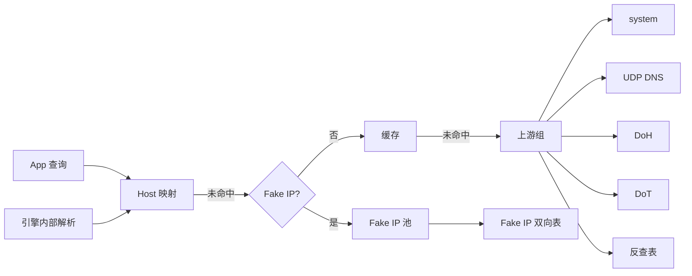

# 07 DNS

`AetherDNS` 提供两类服务：

1. **应答方**：回答设备上其它 App 发出的 DNS 查询（经 TUN 到达 `198.18.0.2:53`，或被 `hijack-dns` 劫持的查询）。
2. **解析方**：为引擎内部解析域名——规则匹配需要 IP、DIRECT 连接、代理节点服务器地址、DoH / DoT 服务器自身。

## 1. 组成



| 组件 | 职责 |
| --- | --- |
| `DNSMessage` | RFC 1035 报文编解码；名称压缩（解码时防指针环）；EDNS(0) OPT 记录原样保留；类型 A、AAAA、CNAME、PTR、SOA、HTTPS / SVCB 结构化，其余为不透明 RDATA |
| `HostTable` | `[Host]` 的静态映射、别名、按域名指定上游 |
| `FakeIPPool` | Fake IP 分配、双向映射、持久化 |
| `DNSCache` | 正向与否定缓存、在途查询合并 |
| `UpstreamGroup` | 一组上游的并发查询与结果选择 |
| `ReverseTable` | 真实 IP → 域名 |
| `DNSService` | 对外门面：`answer(query:)`、`resolve(host:purpose:)` |

### 1.1 实现说明（M2）

- 全部组件绑定到数据面 EventLoop；缓存过期与超时取 `EventLoop.now`，测试用 `EmbeddedEventLoop` 推进时间。
- 上游应答**不重新编码**：转发时只改写原始报文中的事务 ID、问题节名称的大小写（与查询一致）与各记录的 TTL（缓存命中时减去已缓存的秒数，最低 1），其余字节原样返回。`DNSMessage` 对非结构化类型保留原始 RDATA，其中可能含压缩指针，因此解码得到的上游报文不得再编码。
- 自己合成的应答（Host、Fake IP、空答案、PTR、FORMERR、SERVFAIL）复制查询的 RD / CD 位并置 RA；查询带 EDNS(0) 时附带声明 1232 字节的 OPT 记录。
- `[Host]` 别名在应答流程中同样生效：A / AAAA 查询按别名目标解析后以原域名、TTL 60 应答。
- 普通 UDP 上游每次查询使用新的 socket（随机源端口），只接受来自目标服务器、事务 ID 一致的应答。
- `system` 上游的服务器列表由平台注入：隧道用 libresolv（M2-09），`aether-cli` 读 `/etc/resolv.conf`。
- 同时进行的上游查询上限 256（06 §13）：超出时应答方回复 SERVFAIL，解析方以 `DNS-004` 失败；在途合并的查询不占名额。
- TUN 上发往 DNS 地址的 TCP 连接由 `DNSStreamServerHandler` 处理：最多 16 个未完成的查询（超出后暂停读取），未成帧数据超过 64 KiB 时关闭连接。
- M2 中 `encrypted-dns-server` 的 DoH / DoT 上游尚未实现（M3-11）：配置了也退回 `dns-server` 组，并记录一条 notice 日志。

## 2. 查询入口

| 入口 | 处理 |
| --- | --- |
| UDP 到 `198.18.0.2:53` | 应答流程（§2.1） |
| TCP 到 `198.18.0.2:53` | 同上，按 2 字节长度前缀分帧（截断后客户端会改用 TCP 重试） |
| 命中 `hijack-dns` 的 UDP / TCP 53 | 同上，回复的源地址保持为原目标 |
| 引擎内部 `resolve(host:purpose:)` | 解析流程（§2.2），从不返回 Fake IP |

### 2.1 应答流程

1. 解析报文；问题数不为 1 → `FORMERR`。
2. `[Host]` 静态映射命中，且查询类型为 A / AAAA → 返回静态地址，TTL 60。
3. `dns-mode = fake-ip`，查询类型为 A，且域名不在真实 IP 例外中 → 返回 Fake IP（§3）。
4. 查询类型为 AAAA 且 `ipv6 = false` → `NOERROR` 空答案。
5. `dns-mode = fake-ip` 且查询类型为 HTTPS（65）/ SVCB（64）→ `NOERROR` 空答案（避免客户端从这些记录拿到真实地址提示或 ECH 配置）。
6. 查询 Fake IP 段的 PTR → 返回映射的域名。
7. 其余 → 走缓存与上游，原样返回真实答案（改写事务 ID），A / AAAA 结果写入反查表。

响应长度：查询带 EDNS(0) 时上限取其声明值与 1232 的较小者，否则 512；超长则置 TC 位截断。

### 2.2 解析流程

`resolve(host:purpose:)` 的 `purpose` 为 `.routing`（规则需要 IP）、`.direct`（DIRECT 连接）、`.server`（代理节点或加密 DNS 服务器地址）。

1. `[Host]`：静态地址直接返回；别名改为解析目标；`server:` 指定上游时使用该上游。
2. 缓存。
3. 上游组：`.server` 用途使用 `dns-server` 组（避免加密 DNS 自举循环）；其它用途在配置了 `encrypted-dns-server` 时用加密组，否则用 `dns-server` 组。
4. 结果写入缓存与反查表。

所有上游流量从隧道进程直接发出（DIRECT），不经过代理。

## 3. Fake IP

### 3.1 分配

- 地址段 `fake-ip-range`（默认 `198.18.0.0/15`，约 13 万个地址），保留网络地址、`198.18.0.1`（TUN）、`198.18.0.2`（DNS）与广播地址。
- 双向映射：域名 → IP、IP → 域名。按"最近使用"（查询或连接都算使用）维护 LRU；地址用尽时回收最久未用的映射（`DNS-010` 写入日志，仅首次）。
- Fake 答案 TTL 为 1 秒：系统解析器不会长期缓存 Fake IP，隧道停止后很快失效。
- 引擎遇到不在映射表中的 Fake IP 目标时拒绝连接（`NET-010`），不猜测。

### 3.2 持久化

- 停止隧道时、以及运行中每 5 分钟（有变化时），把最近使用的 16,384 条映射写入 `State/fakeip.bin`（原子写）。
- 启动时加载，保证系统或 App 缓存的 Fake IP 在隧道重启后仍可用。
- 文件格式：魔数 `AEFI`、格式版本（1 字节，当前为 1）、条目数（UInt32），之后为 `(IPv4 偏移量 UInt32, 域名长度 UInt8, 域名 UTF-8)` 序列，整数大端，最近使用在前；格式不符时整个丢弃，越界或落在保留地址上的条目逐条跳过。

### 3.3 真实 IP 例外

以下域名在 Fake IP 模式下仍返回真实解析结果。`always-real-ip` 写在配置中时替换内置表，模块可用 `%APPEND%` 追加。

内置表：

```text
*.lan, *.local, *.localdomain, *.home.arpa, localhost,
captive.apple.com, time.apple.com, time-ios.apple.com, *.ntp.org, stun.*
```

理由：局域网名称、强制门户检测、时间同步、STUN 需要真实地址才能正常工作。

### 3.4 IPv6（M7）

`ipv6 = true` 时，AAAA 查询返回 `fd00:ae7e:1::/64` 段中的 Fake IPv6 地址，双向映射与 IPv4 共用同一 LRU；隧道网络设置同时包含该段的路由。M2–M6 中 `ipv6 = true` 给出 `CFG-099` 并按 `false` 处理。

## 4. 上游

| 类型 | 写法 | 规范 | 要点 | 里程碑 |
| --- | --- | --- | --- | --- |
| system | `system` | — | 见 §4.1 | M2 |
| UDP | `223.5.5.5`、`[2001:db8::1]:53` | RFC 1035 | 超时 2 秒，重试 1 次；响应截断时改用 TCP | M2 |
| DoH | `https://dns.example/dns-query` | RFC 8484 | `POST application/dns-message`；优先 HTTP/2，回退 HTTP/1.1；连接池保持长连接；默认验证证书 | M3 |
| DoT | `tls://dns.example[:853]` | RFC 7858 | 2 字节长度分帧；复用连接，允许流水线 | M3 |
| DoQ | `quic://dns.example` | RFC 9250 | 随 QUIC 预研 | M7 |

### 4.1 系统 DNS

隧道把系统 DNS 设成了自己（`198.18.0.2`），所以"系统 DNS"指物理网络下发的 DNS 服务器：

1. 用 libresolv（`res_9_ninit` / `res_9_getservers`）读取服务器列表，排除 TUN 与 Fake IP 段内的地址；
2. 若结果为空，回退为在 NIO 线程池中调用 `getaddrinfo`（只能解析 A / AAAA）；
3. 网络修订号变化时重新读取。

🔬 两种方式在隧道进程中得到的都应是物理网络的解析结果，需真机验证；验证失败时改为要求用户在 `dns-server` 中显式配置上游，并在首页提示。

### 4.2 查询策略

- 同一组内所有上游**并发**查询，采用第一个 `NOERROR` 或 `NXDOMAIN` 响应；`SERVFAIL`、`REFUSED`、超时则等待其它上游。
- 整体超时 5 秒，超时返回 `SERVFAIL`（应答方）或 `DNS-001`（解析方）。
- 每个上游记录最近 20 次耗时与失败次数，供 DNS 诊断页展示。

## 5. 缓存

| 项 | 规则 |
| --- | --- |
| 键 | 规范化域名 + 类型 + 类 + 上游组 |
| 正向 TTL | 采用答案中最小 TTL，下限 10 秒，上限 1 天 |
| 否定缓存 | `NXDOMAIN` / `NODATA` 按 SOA 最小值，限制在 10–300 秒；`SERVFAIL` 缓存 5 秒 |
| 容量 | LRU 4,096 条 |
| 在途合并 | 相同键的并发查询共享一次上游请求 |
| 失效 | 网络修订号变化时清空来自 `system` 上游的条目；"清空 DNS 缓存"操作清空全部正向与否定缓存（不清 Fake IP 表） |

## 6. DNS 反查表

- 记录 Aether 返回给 App 或为路由解析得到的"真实 IP → 域名"，LRU 4,096 条。
- 引擎遇到目标为真实 IP 的连接时用它恢复主机名（`hostSource = .dnsReverse`），让域名规则对"真实 IP 模式"和"真实 IP 例外"中的流量也能生效。
- 一个 IP 对应多个域名时保留最近一次。

## 7. 真实 IP 模式

`dns-mode = real-ip` 时应答流程跳过第 3 步，A 查询也返回真实结果。TUN 流量的主机名只能靠反查表与嗅探恢复，域名规则的覆盖率会下降；该模式主要用于排查 Fake IP 引起的兼容问题。设置页切换时给出说明。

## 8. 工具与观测

通过 IPC 提供（[10](10-control-ipc.md)）：

- DNS 缓存列表：域名、类型、答案、剩余 TTL、上游、耗时；
- Fake IP 映射列表：域名、地址、最近使用时间；
- 清空缓存；
- 上游测速：对每个上游查询 `www.apple.com` 的 A 记录并显示耗时或错误；
- 手动查询：输入域名与类型，显示完整处理路径（Host 映射 / Fake / 缓存 / 哪个上游）。

## 9. 错误码

| 码 | 含义 |
| --- | --- |
| `DNS-001` | 查询超时 |
| `DNS-002` | 上游返回 SERVFAIL |
| `DNS-003` | 域名不存在（NXDOMAIN） |
| `DNS-004` | 无法连接上游 |
| `DNS-005` | 上游响应格式错误 |
| `DNS-006` | 加密 DNS 的 TLS 失败 |
| `DNS-010` | Fake IP 地址池已满，开始回收 |
| `DNS-011` | 没有可用的系统 DNS 服务器 |

## 10. 测试要求

| 测试 | 内容 |
| --- | --- |
| 报文 | 压缩名称、指针环、截断报文、超长标签、EDNS 透传；对编解码器做模糊测试 |
| Fake IP | 分配、反查、LRU 回收、持久化往返、保留地址不被分配 |
| 应答流程 | 每一步的优先级（Host > Fake > AAAA 规则 > HTTPS 记录 > 上游） |
| 缓存 | TTL 上下限、否定缓存、在途合并、网络变化失效 |
| 上游 | UDP 截断转 TCP；DoH / DoT 对本地测试服务器；并发取首个成功 |
| 互通 | 对公共 DoH / DoT 服务的冒烟测试只在手动触发的工作流中运行，不进入常规 CI |
