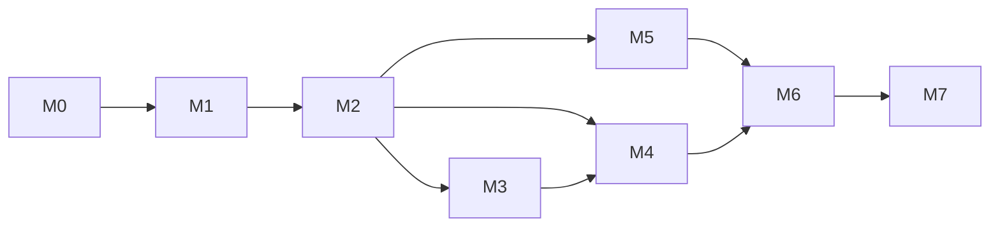

# 14 路线图

每个任务的粒度约为一个提交（或一组连续提交），直接推送到 `main`。任务编号写在提交信息中（如 `feat(engine): [M2-06] SOCKS5 outbound`），约定见 [03 §8.2](03-project-setup.md#82-分支与提交)。

任务状态在本文件中维护：`[ ]` 未开始、`[~]` 进行中、`[x]` 完成。完成一个任务时，在同一个提交中更新它的状态。

**通用完成标准**（每个任务都必须满足，下文不再重复）：

1. 代码符合 [03 §9](03-project-setup.md#9-代码规范) 与 [CLAUDE.md](../CLAUDE.md)；
2. 新逻辑有测试，CI 全绿；
3. 行为与文档一致——实现中发现文档有误或需要调整时，在同一个提交中修改文档并在提交说明中写清原因；
4. 不引入未登记的依赖。

---

## M0：工程骨架（v0.1）

目标：工程能构建；App 能安装 VPN 配置并启动一个不接管流量的空隧道。

执行顺序：M0-01 → M0-02 → M0-05 → M0-03 → M0-04 → M0-08 → M0-06 → M0-07。CI（M0-05）提前到第一份 Swift 代码之后，此后每次推送都有 Linux 与 macOS 两侧验证；M0-03、M0-04 各自把 hev 构建、XcodeGen 与 `xcodebuild` 步骤加入 `ios.yml`。M0-08 依赖 M0-04 的 Xcode 工程。

M0 中的其它约定：外部 Swift 包在首次使用它的任务中引入（M0 只引入 swift-log）；`AetherErrorProtocol` / `AetherErrorCode` 的最小版本从 M1-01 提前到 M0-06。

| 状态 | 编号 | 任务 | 参考 | 完成标准 |
| --- | --- | --- | --- | --- |
| [x] | M0-01 | 仓库初始化：目录结构、`.gitignore`、`.swift-format`、`CHANGELOG.md`、文档与示例就位 | 03 §1、§9 | 结构与 03 §1 一致 |
| [x] | M0-02 | `AetherKit` 包骨架：全部模块的空壳与占位测试、平台条件声明 | 02 §3、03 §5.4 | Linux 与 macOS 上 `swift build` / `swift test` 通过 |
| [x] | M0-03 | Vendored C 库：hev submodule、`build-hev.sh`、模块映射；BLAKE3 源码与 `CBlake3` | 03 §6 | xcframework 可生成；BLAKE3 官方测试向量通过 |
| [x] | M0-04 | XcodeGen 工程：`project.yml`、xcconfig、Info.plist、entitlements、隐私清单；App 与 Tunnel target；`bootstrap.sh` | 03 §3、§4 | `xcodebuild build` 成功 |
| [x] | M0-05 | CI：`core.yml`、`ios.yml` | 03 §7 | 两个工作流在推送 `main` 时运行并通过 |
| [x] | M0-06 | `AppEnvironment`；日志基础设施（os.Logger 后端 + 滚动文件） | 03 §3.2、02 §8.2 | 缺少 Info.plist 键时给出明确错误；日志文件滚动测试 |
| [x] | M0-07 | 最小闭环：`AetherControl` 中的 `TunnelController`（安装、启动、停止、状态）与 `TunnelClient`，App 首页开关；隧道应用只包含 `198.18.0.0/15` 路由、不改 DNS 的网络设置后进入 running；IPC `getStatus` 往返 | 10 §2、§4 | 真机 V01；开启空隧道时正常上网不受影响 |
| [x] | M0-08 | 发布工作流 `release.yml`：`v*` tag 与手动触发（`workflow_dispatch`）；未签名 ipa、entitlements 与标识符清单；标识符可由仓库变量覆盖 | 03 §8.3–§8.4 | 手动触发产出结构正确的 ipa 与附带文件 |

## M1：配置内核（v0.2）

目标：配置的解析、校验、模块叠加、编辑与规则引擎完整可用，不涉及网络。

计划（2026-10-29）：

- 顺序：按编号 M1-01 → M1-11。M1-07 通过 `RuleResourceProvider` 协议接入规则集，M1-08 再提供解析器、内置 `LAN` 与编译缓存。
- `AetherFoundation`（M1-01）：`IPAddress`（v4 用 `UInt32`、v6 用两个 `UInt64`，IPv4 映射地址可互转）、`CIDR`、`Hostname`（ASCII 小写、去末尾点、按标签转 Punycode，保留原拼写）、`Endpoint`、有上限的 `LRUCache`、字节工具；Punycode 按 RFC 3492 实现并通过 RFC §7.1 全部示例。IDNA 映射只做 Unicode 小写化，不实现完整 UTS #46（在 05 §3.3 注明）。
- `AetherProfile`（M1-02–M1-06）：逐行无损的 `ProfileDocument`（BOM、CRLF、注释、未知内容原样保留）；带引号与括号深度的字段分词器；各节解析为 Spec 类型并产出诊断（04 §13 全部诊断码）；语义校验；模块元数据、参数替换与叠加；`ResolvedProfile.revision` 为全部源文本与参数的 SHA-256，用 swift-crypto 计算（依赖表中已登记的包，此时引入并把 `AetherProfile` 加入其使用模块）。正则一律用 `NSRegularExpression`（ICU 语法，Linux 与 Apple 一致）。
- 模糊测试：解析器提供固定种子的变异模糊测试（在 `swift test` 中运行，CI 每次推送执行），保证任意输入不崩溃、不死循环，且未修改的文档渲染与输入逐字节一致。
- `AetherRules`（M1-07–M1-08）：`RouteContext` / `RuleProgram` / `RuleStep` 按 05 §1–§2；分块编译（域名哈希表、排序反转域名表、关键字线性或 Aho-Corasick、IP 区间表）；`needsResolution` 续算；追踪模式；4096 条 LRU 决策缓存；块模式与逐条模式一致性的属性测试（固定种子）。
- `aether-cli`（M1-09）：`check`、`match`、`render --redact`；输出稳定，用黄金文件测试。
- M1-10：`Tests/Fixtures/profiles/compat/` 下 ≥ 10 份风格各异的配置及期望诊断与解析摘要。
- M1-11：不引入基准测试框架（避免新依赖），新增可执行目标 `aether-bench`，Release 构建运行，结果写入 CI 摘要。
- 版本：`MARKETING_VERSION` 改为 0.2.0；M1 结束时 tag `v0.2.0`。M1 没有真机验收行（13 §6 中无 M1 项），检查点只做 13 §7 自查。

| 状态 | 编号 | 任务 | 参考 | 完成标准 |
| --- | --- | --- | --- | --- |
| [x] | M1-01 | `AetherFoundation`：`IPAddress`、`CIDR`、`Hostname`（规范化、Punycode）、`Endpoint`、LRU、错误协议、字节工具 | 02 §3、05 §3.3 | RFC 3492 Punycode 示例通过 |
| [x] | M1-02 | 词法与无损模型 `ProfileDocument`；解析器模糊测试目标 | 04 §2、§3、§15.1 | 全部 fixtures 往返逐字节一致 |
| [x] | M1-03 | 各节类型化解析为 Spec 类型，产出诊断 | 04 §4–§11 | 每种条目至少一个正例与一个反例 |
| [x] | M1-04 | 语义校验：名称唯一、引用存在、组环检测、FINAL、CIDR / 正则 / 端口 | 04 §13 | 每个 error / warning 诊断码有测试 |
| [x] | M1-05 | 模块：元数据、参数替换、叠加语义；`ResolvedProfile` 与修订号 | 04 §12.1–§12.2 | 叠加顺序与 `%APPEND%` / `%INSERT%` 测试 |
| [x] | M1-06 | 编辑操作与脱敏渲染 | 04 §15.2 | 编辑只改目标行；脱敏覆盖全部敏感字段 |
| [x] | M1-07 | 规则引擎：`RouteContext`、分块编译、反转域名表、区间表、`evaluate` / 续算、追踪模式、决策缓存 | 05 §1–§4 | 05 §9 测试全部通过；块模式与逐条模式一致性属性测试 |
| [x] | M1-08 | 规则集 / 域名集解析、内置 `LAN`、编译缓存格式 | 05 §6 | 含无效行与超限文件的测试 |
| [x] | M1-09 | `aether-cli`：`check`、`match`、`render --redact` | 05 §8.2 | 对 fixtures 输出稳定 |
| [x] | M1-10 | 兼容 fixtures：≥ 10 份风格各异的配置及期望诊断 | 04 §14 | 纳入回归测试 |
| [x] | M1-11 | 基准测试：规则匹配、配置解析 | 05 §5、13 §5.1 | CI 输出基准摘要 |

## M2：最小可用数据面（v0.3）

目标：第一个真机日常可用版本——全流量接管，DIRECT / REJECT / HTTP / SOCKS5 节点，规则分流，手动选择组。

计划（2026-10-29）：

- 顺序：M2-01 → M2-02 → M2-03 → M2-04 → M2-06 → M2-05 → M2-07 → M2-08 → M2-12 → M2-09 → M2-10 → M2-11 → M2-13。出站（M2-06）提前到 `Router`（M2-05）之前，使路由的集成测试能覆盖真实的拨号步骤；统计数据库（M2-12）提前到隧道生命周期（M2-10）之前，因为停止流程要落盘统计与日志簿。
- 依赖：按 03 §5.1 在首次使用的任务中引入 swift-nio（M2-01；同时带入其依赖 swift-atomics、swift-collections）、swift-nio-ssl（M2-06，TLS 传输）、GRDB（M2-12），实际版本填入依赖表。swift-nio-extras、swift-nio-http2 不在 M2 引入。
- 数据面全部在 1 个 EventLoop 线程上，以 ChannelHandler 管线 + 胶水 Handler 双向转发（02 §7）；控制面（运行配置编译、IPC、持久化）用 `actor`。新流读取通过锁保护的当前 `RuntimeConfiguration` 引用，已有流持有自己的引用直到结束。
- `AetherDNS`（M2-02）：`DNSMessage` 编解码（名称压缩、指针环保护、EDNS 透传、A / AAAA / CNAME / PTR / SOA / HTTPS / SVCB 结构化）、`FakeIPPool`（LRU 回收、`fakeip.bin` 往返）、`HostTable`、`DNSCache`（TTL 上下限、否定缓存、在途合并）、`ReverseTable`、UDP 上游（超时、重试、截断转 TCP）、`system` 上游（服务器列表由平台注入：隧道用 libresolv，Linux 的 `aether-cli` 读 `/etc/resolv.conf`）、并发上游组、`DNSService` 门面；时间通过注入的时钟控制。DNS 报文编解码加入 `aether-bench`。
- `AetherOutbound`（M2-06）：`OutboundConnector` / `Destination` / `DialContext` 按 06 §8.1；连接器的配置类型由本模块定义，`AetherEngine` 把 `ProxySpec` 转换过来（`AetherOutbound` 不依赖 `AetherProfile`）。DIRECT 以 NIO 的 Happy Eyeballs 拨号，解析经注入的 `ServerAddressResolver`；NAT64 合成经注入的合成器（Apple 平台为线程池中的 `getaddrinfo`）。
- `AetherEngine`：`FlowManager` 与胶水 Handler（M2-01）、内部 SOCKS5 入站（M2-03，认证成功即回复，以便嗅探首包）、HTTP 代理入站（M2-04，明文绝对形式请求由 `AetherHTTP` 中的最小 HTTP/1 转发实现，完整管线在 M5）、`Router` 与嗅探（M2-05）、`PolicyRegistry` 与运行配置热替换（M2-07；`url-test` / `fallback` / `load-balance` 在 M3-07 之前解析到第一个成员并在 `listPolicies` 中如实标注）、UDP 关联与 NAT 表（M2-08）、`aether-cli run`（13 §4）。
- 运行包：配置库（`Profiles/index.json`）、模块库与运行包提交（11 §3.1、§6）放在 `AetherIPC`（`ProfileLibrary`、`RunBundle`，只依赖 Foundation，路径来自 `SharedContainer`），App 与引擎共用并可在 Linux 上测试；修订号由 App 用 `AetherProfile` 计算后传入；`runtime.json`、`selections.json`、`RequestRecord` 等跨进程模型放在 `AetherIPC`。
- `AetherStore`（M2-12）：GRDB `DatabasePool`；迁移 `v1_initial` 一次建出 11 §4.1 的全部表（迁移只追加，后续里程碑直接使用）；M2 写 `traffic_daily` 与 `logbook`，并实现 11 §4.2 的清理。
- `AetherTunnelSupport`（M2-09、M2-10）：完整网络设置、utun 描述符查找（`ctl_info` / `sockaddr_ctl` 按内核 ABI 在 C 目标 `CAetherTunnel` 中声明，与 06 §4.1 一致）与备用 socketpair 桥接、hev 配置与线程、`NWPathMonitor` 与 SSID、libresolv 系统 DNS、`RLIMIT_NOFILE`、内存压力源、Darwin 通知、状态快照。
- App（M2-11）：五个标签的骨架；首页（连接、出站模式、流量、常用组）、策略页（select）、请求列表与基础详情、配置页（URL / 文件导入、提交运行包）、诊断页；每个页面带 `MockTunnelClient` 的 `#Preview`（含空状态与错误状态）。
- 测试：集成测试在进程内启动引擎（NIOPosix），上游是测试里启动的本地 HTTP / SOCKS5 / HTTP CONNECT / DNS 服务，全部只用回环地址，不访问公网。
- M2-13：V02–V12 写成 13 §6.1 的验收步骤，标"待验证"；hev 参数保持 06 §4.2 的初值，待真机压测（V10）后回填。
- 版本：`MARKETING_VERSION` 改为 0.3.0；M2 结束时 tag `v0.3.0`。

| 状态 | 编号 | 任务 | 参考 | 完成标准 |
| --- | --- | --- | --- | --- |
| [x] | M2-01 | NIO 基础：EventLoopGroup 管理、胶水 Handler（背压、半关闭、计数）、`FlowManager`、超时 | 06 §6.1、§13 | 慢速消费者下内存不增长的测试 |
| [x] | M2-02 | DNS：报文编解码、Fake IP 池与持久化、`HostTable`、缓存、UDP 与 system 上游、应答与解析流程 | 07 §1–§5 | 07 §10 中 M2 相关测试 |
| [x] | M2-03 | 内部 SOCKS5 入站（认证、CONNECT、UDP ASSOCIATE） | 06 §5.1 | 集成测试 |
| [x] | M2-04 | HTTP 代理入站（CONNECT、绝对形式请求转发） | 06 §5.2 | 集成测试 |
| [x] | M2-05 | `Router`：主机名恢复、嗅探、出站模式、规则匹配与解析续算、策略解析、前置检查、请求记录 | 06 §6、§7、§12.2 | 集成测试覆盖 06 §6 每一步 |
| [x] | M2-06 | 出站：DIRECT（Happy Eyeballs、NAT64 合成）、拒绝系列、HTTP / HTTPS、SOCKS5（含 UDP）、TLS 传输 | 06 §8 | 集成测试；拒绝策略行为测试 |
| [x] | M2-07 | `select` 组与选择持久化；`PolicyRegistry`；运行配置装配与热替换 | 06 §9.1、§14 | 热替换不中断已有连接的测试 |
| [x] | M2-08 | UDP 关联与 NAT 表；DNS 包分流 | 06 §10 | 集成测试 |
| [x] | M2-09 | `AetherTunnelSupport`：网络设置构建、utun 描述符查找与备用桥接、hev 桥接、路径监控、`RLIMIT_NOFILE` | 06 §3、§4、§11 | 网络设置构建的单元测试；真机 V07 |
| [x] | M2-10 | 隧道生命周期（启动、停止、重载、休眠唤醒）、状态快照、Darwin 通知、内存压力处理、IPC 分发器与 M2 命令 | 06 §2、10 §2–§3、02 §6 | completion 只调用一次的测试；真机 V02–V04 |
| [x] | M2-11 | App：配置导入（URL、文件）与提交运行包、首页、策略页（select）、请求列表与基础详情、诊断页 | 11 §6、12 §4–§6 | 每个页面有 mock 数据预览 |
| [x] | M2-12 | 统计：计数、采样器、数据库（`traffic_daily`、`logbook`）与迁移 | 06 §12、11 §4 | 数据库迁移测试 |
| [x] | M2-13 | 真机验收与参数定值 | 13 §6 | V02–V12 的验收步骤写入 13 §6.1（状态"待验证"）；hev 参数保持 06 §4.2 的初值，V10 实测后回填 |

## M3：协议、策略组、订阅与外部资源（v0.4）

计划（2026-10-30）：

- 顺序：M3-02 → M3-01 → M3-13 → M3-03 → M3-05 → M3-04 → M3-06 → M3-07 → M3-11 → M3-08 → M3-10 → M3-09 → M3-12 → M3-14。传输层（M3-02）先行，因为 Trojan / VMess / VLESS 都要叠加在 WebSocket 上；互通工作流（M3-13）紧跟第一个新协议，使之后每个协议在合入时就有真实服务端验证；测速（M3-07）需要的经策略 HTTP 请求在 `AetherHTTP` 中实现一个最小 HTTP/1.1 客户端，DoH（M3-11）与隧道侧资源下载（M3-08）复用它；订阅（M3-09）与远程规则集（M3-10）依赖资源管理（M3-08）。
- 出站分层（06 §8.1）：`ProxyServer` 增加传输栈描述（TLS、WebSocket、simple-obfs），连接器 = Dialer → 传输层逐层叠加 → 协议 Handler；每层完成握手后把自身替换为纯编解码 Handler，最后统一交给回放 Handler，保持 M2 的 `autoRead` 约定。WebSocket 用 swift-nio 自带的 `NIOWebSocket`（不引入新包）。
- 密码学（06 §8.4）：AEAD、哈希、HKDF 用 swift-crypto（`Insecure.MD5`、`HKDF<Insecure.SHA1>`、`AES.GCM`、`ChaChaPoly`）；swift-crypto 缺少的 SHA-224、AES 单块加密、CRC32、FNV-1a、VMess 的嵌套 HMAC KDF 在 `AetherOutbound/Crypto/` 中实现，每个都附 RFC / FIPS / 官方实现的测试向量；BLAKE3 用 M0 已建立的源码 target `CBlake3`（`Vendor/blake3` 的符号链接，关闭 SIMD 分支，已有官方测试向量），M3-06 直接使用。不实现 SHAKE128（VMess 只置 ChunkStream，🔬 由互通测试确认服务端接受）。
- 互通测试（M3-13）：开发会话的容器仓库（ghcr.io、Docker Hub）拉取被拒，而 GitHub Release 可以下载，因此服务端改为固定版本的官方 Release 二进制（Xray-core、shadowsocks-rust），由 `Scripts/interop/servers.env` 记录版本、下载地址与 SHA-256，`fetch-servers.sh` 下载并校验；simple-obfs 用 Ubuntu 软件源中的 `simple-obfs` 包；源站、UDP 回显与 DNS 服务由测试进程在回环地址上启动（`AetherTestSupport`）。工作流 `interop.yml` 在 `swift:6.4-noble` 容器中运行 `Scripts/interop/run.sh`（与本地一致），结果写入 CI 摘要；同步修改 13 §3.1 与 03 §2、§7 中的 docker compose 描述。测试目标 `AetherInteropTests` 没有 `AETHER_INTEROP` 环境变量时整体跳过，不影响 `swift test`。
- 策略组（M3-07）：`PolicyRegistry` 保存测速结果（按节点身份）、被动失败计数与降级期；调度器使用注入的时钟，活跃判定、去抖、全局并发 8 均可在测试中控制；测速请求经 `AetherHTTP` 的最小客户端在所选连接器上完成（HTTPS 测速 URL 在隧道内做 TLS）。
- 外部资源（M3-08）：元数据、缓存文件布局、校验与原子替换放在 `AetherIPC`（App 与隧道共用，只依赖 Foundation）；gzip 解压用纯 Swift 的 inflate 实现（RFC 1951 / 1952，带固定测试数据），不引入 zlib（03 §5.2 未登记）；App 侧下载用 `URLSession`，隧道侧用引擎的 HTTP 客户端并按 `resource-fetch-policy` 出站；调度、退避使用注入的时钟。
- DoH / DoT（M3-11）：DoT 为 2 字节长度分帧的 TLS 长连接；DoH 按 07 §4 优先 HTTP/2，在本任务首次使用时引入依赖表中已登记的 swift-nio-http2（ALPN 协商失败时回退 HTTP/1.1）；上游拨号经 `DIRECT`，证书默认完整验证。
- 订阅与转换（M3-09、M3-12）：INI / YAML / URI 列表解析在 `AetherProfile`，YAML 用依赖表中已登记的 Yams（M3-09 引入）；导入统计（成功、跳过及原因）随 `ResolvedProfile` 输出，订阅节点以只读形式参与策略组成员展开。
- MMDB（M3-10）：读取器在 `AetherRules`，文件以只读方式映射；测试数据库在测试中按 MaxMind DB 格式规范生成（不提交第三方数据库），并覆盖截断、越界指针、指针环等损坏输入。
- App（M3-14）：节点详情与测速、规则测试（隧道运行时用 IPC `matchRule`，未运行时直接用 `AetherRules` 的追踪模式）、外部资源页、DNS 页（缓存、清空）；每个页面带 `MockTunnelClient` 的 `#Preview`（含空状态与错误状态）。
- 真机项：V13–V17 写成 13 §6.1 的验收步骤，标"待验证"。
- 版本：`MARKETING_VERSION` 改为 0.4.0；M3 结束时 tag `v0.4.0`。

| 状态 | 编号 | 任务 | 参考 | 完成标准 |
| --- | --- | --- | --- | --- |
| [x] | M3-01 | Shadowsocks AEAD（TCP / UDP）、simple-obfs http | 06 §8.4–§8.5 | 测试向量 + 互通 |
| [x] | M3-02 | WebSocket 传输 | 06 §8.5 | 与 NIO 服务端升级器的回环互通测试；与 Xray 的互通随 M3-13 起覆盖各协议的 WS 组合 |
| [x] | M3-03 | Trojan（TLS、WS+TLS、UDP） | 06 §8.4 | 互通 |
| [ ] | M3-04 | VMess AEAD（TCP、WS、TLS、UDP） | 06 §8.4 | 互通；确认 ChunkMasking 结论并回填 |
| [x] | M3-05 | VLESS（TLS、WS+TLS、UDP） | 06 §8.4 | 互通 |
| [ ] | M3-06 | Shadowsocks 2022（TCP、AES 变体 UDP）、simple-obfs tls | 06 §8.4 | 测试向量 + 互通 |
| [ ] | M3-07 | `url-test` / `fallback` / `load-balance`；测速与被动降级；IPC `testPolicies` / `getTestResults` | 06 §9 | 集成测试（模拟延迟与失败） |
| [ ] | M3-08 | 外部资源管理：两侧下载、元数据、条件请求、gzip、校验、退避、调度、后台刷新 | 11 §5 | 单元测试 + 真机 V16 |
| [ ] | M3-09 | `policy-path` 订阅：INI、YAML、URI 列表；`include-all-proxies`、`include-other-group`、正则过滤 | 04 §6.2、§12.4 | 每种格式的 fixtures |
| [ ] | M3-10 | 远程 `RULE-SET` / `DOMAIN-SET`；MMDB 读取器；`GEOIP` / `IP-ASN` | 05 §6–§7 | MMDB 测试数据库与损坏文件测试 |
| [ ] | M3-11 | DoH / DoT 上游；按域名指定上游 | 07 §4 | 对本地测试服务的测试 |
| [ ] | M3-12 | 托管配置；整份 YAML 配置转换 | 04 §12.3、§12.5 | fixtures |
| [x] | M3-13 | 互通测试工作流 `interop.yml` | 13 §3 | 每日运行；之后每个协议任务把自己的组合加入 `InteropCase.all` 与 `xray.json` |
| [ ] | M3-14 | App：节点详情、测速、规则测试工具、外部资源页、DNS 页 | 12 §5、§8 | 预览 + 真机 V13–V15、V17 |

## M4：App 完整体验（v0.5）

| 状态 | 编号 | 任务 | 参考 | 完成标准 |
| --- | --- | --- | --- | --- |
| [ ] | M4-01 | 编辑器文本模式（Runestone、高亮、诊断、查找替换） | 12 §7.2 | 1 万行配置流畅编辑 |
| [ ] | M4-02 | 编辑器表单模式（基于 `ProfileDocument` 编辑操作） | 12 §7.2、04 §15.2 | 表单编辑后往返测试 |
| [ ] | M4-03 | 模块管理（安装确认、参数、排序）；"快速规则"模块 | 12 §7.3、§6.2 | — |
| [ ] | M4-04 | 请求页完善（筛选、搜索、增量刷新、终止、添加规则） | 12 §6 | — |
| [ ] | M4-05 | 流量统计页；`traffic_host_daily`、`rule_usage` | 12 §8、11 §4 | — |
| [ ] | M4-06 | 日志与日志簿页；`getLogs` / `setLogLevel` | 12 §8 | — |
| [ ] | M4-07 | 设置页、按需连接、首次启动引导 | 12 §3、§9、10 §4 | 真机 V19 |
| [ ] | M4-08 | 小组件、控制中心开关、App Intents、URL Scheme | 12 §10、10 §5、§7 | 真机 V18（结论回填 10 §7） |
| [ ] | M4-09 | `SUBNET` 规则与 SSID 读取 | 05 §3.3、06 §11 | 真机 V20 |
| [ ] | M4-10 | 本地化（简体中文、英文）、无障碍检查、开源许可页生成 | 01 §6、12 §12 | 无遗漏的界面文案 |
| [ ] | M4-11 | 二维码与剪贴板导入；DNS 工具完善（Fake IP 列表、上游测速、手动查询） | 12 §7.1、07 §8 | — |

## M5：MitM、重写与抓包（v0.6）

| 状态 | 编号 | 任务 | 参考 | 完成标准 |
| --- | --- | --- | --- | --- |
| [ ] | M5-01 | 证书（`AetherCertificates` + App 侧 Keychain 与信任检测）：CA 生成、存储、导入导出、叶子签发 | 08 §2 | 08 §11 证书测试 |
| [ ] | M5-02 | CA 安装引导（临时服务、文件导出） | 08 §2.3 | 真机 V21 |
| [ ] | M5-03 | TLS 终止、上游验证、升级请求透传、证书固定自动跳过 | 08 §3–§4 | 集成测试 |
| [ ] | M5-04 | HTTP 管线完整版：顺序、Body 缓冲 / 解压 / 重编码、上限 | 08 §5–§6 | 管线顺序测试 |
| [ ] | M5-05 | URL Rewrite、Header Rewrite、Body Rewrite、Map Local | 04 §9、08 §7 | 每种类型的测试 |
| [ ] | M5-06 | 抓包存储与展示；HAR、cURL 导出 | 08 §8 | HAR schema 校验 |
| [ ] | M5-07 | 功能开关 IPC；首页开关与提醒 | 10 §2.2、12 §4 | 真机 V22–V23 |

## M6：脚本与 1.0 稳定性（v1.0）

| 状态 | 编号 | 任务 | 参考 | 完成标准 |
| --- | --- | --- | --- | --- |
| [ ] | M6-01 | `AetherScriptCore`（协议、值类型、`ScriptHostServices`、cron 解析）；JavaScriptCore 运行时：工作线程、上下文、预置脚本、超时与作废、看门狗、内存策略 | 09 §3 | 死循环与超时测试 |
| [ ] | M6-02 | 全局 API | 09 §4、§6–§8 | API 单元测试 |
| [ ] | M6-03 | http-request / http-response 接入 HTTP 管线 | 09 §5、08 §5 | `$done` 语义测试 |
| [ ] | M6-04 | cron、event、generic；快捷指令"运行脚本" | 09 §2 | — |
| [ ] | M6-05 | 脚本编辑器与调试；脚本存储页 | 09 §10、12 §8 | — |
| [ ] | M6-06 | 兼容脚本套件 | 09 §12 | 全部通过 |
| [ ] | M6-07 | 稳定性：24 小时运行、内存优化、MetricKit 诊断展示 | 13 §5–§6 | 真机 V24–V27；全部历史验收行复测 |
| [ ] | M6-08 | 1.0 发布准备：文档与功能列表同步、隐私清单、版本号 | 13 §7 | 里程碑检查表全部勾选 |

## M7：进阶（v1.x）

各项相互独立，按需排期。标注"预研"的任务先产出一份技术方案（写入 02 §10 作为新的 ADR），评审通过后再实现。

| 状态 | 编号 | 任务 | 参考 |
| --- | --- | --- | --- |
| [ ] | M7-01 | HTTP 控制接口（含 `/v1/metrics`）与 `$httpAPI` | 10 §6 |
| [ ] | M7-02 | 局域网共享（HTTP / SOCKS5） | 06 §5.3 |
| [ ] | M7-03 | IPv6：Fake IPv6、`ipv6 = true` | 07 §3.4 |
| [ ] | M7-04 | HTTP/2 MitM（`h2 = true`） | 08 §4 |
| [ ] | M7-05 | 代理链 `underlying-proxy` | 04 §5.2 |
| [ ] | M7-06 | 预研：QUIC 系协议（Hysteria2、TUIC v5）与 DoQ | 06 §8.4、07 §4 |
| [ ] | M7-07 | 预研：WireGuard 出站 | 06 §8.4 |
| [ ] | M7-08 | QUIC Initial 解密嗅探 SNI | 06 §7 |
| [ ] | M7-09 | `dns` / `rule` 脚本、`SCRIPT` 规则 | 09 §2 |
| [ ] | M7-10 | `subnet` 策略组 | 04 §6.1 |
| [ ] | M7-11 | SS 2022 chacha20 变体 UDP（XChaCha20-Poly1305） | 06 §8.4 |
| [ ] | M7-12 | 分享扩展与导入收件箱 | 02 §2 |
| [ ] | M7-13 | 其它客户端插件 / 重写格式导入 | 04 §14 |
| [ ] | M7-14 | 性能调优：评估 ADR-002（进程内 lwIP）、MTU、EventLoop 线程数 | 02 §10、13 §5 |
| [ ] | M7-15 | 通知媒体附件 | 09 §7 |

---

## 依赖关系

M4 中与 M3 无关的界面任务（编辑器、日志、设置）可以在 M3 进行期间并行开发。
